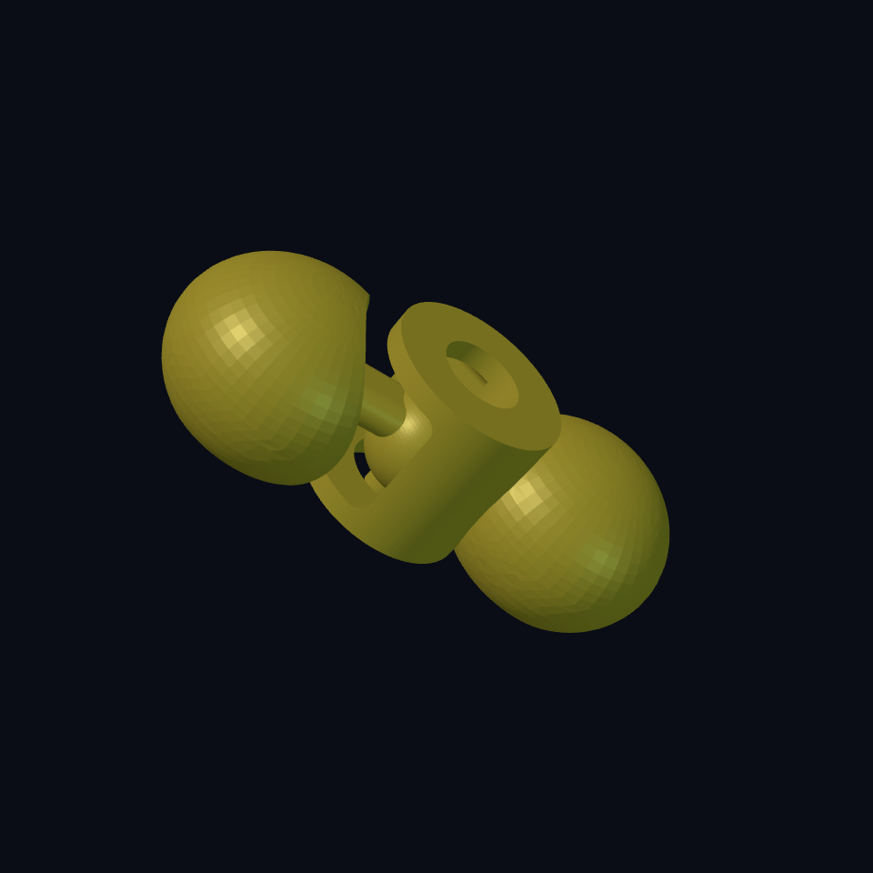

# Chapter 5: A worm that really bends

The **Worm Farm** needs its farmer. A curved solid still stays rigid after printing. Our worm has separate links: a ball on one link sits inside a socket on the next. The links can move while staying captured.

This is the hardest mechanism in the book. Start with two links. Once that joint works, making a longer worm is repetition.

## Find the nine moving pieces {#worm-links}


The complete worm has a head, seven body links, and a tail. They are printed together in a straight row. They must remain **nine separate solids**, even though the balls are already inside their sockets. The straight printing position does not prevent later bending.

Try [the two-link joint sample](../examples/worm-farm/worm-joint-coupon.ecky) first. It is the same ball and socket, without the face or long row. After printing, let it cool and gently check movement. Do not force a fused sample; adjust the gap and print another pair.



## A ball inside a cage {#worm-ball-socket}

Look at one connection from above. The ball belongs to the link on the left. The cage belongs to the link on the right. The gap between them is empty space, not a second material.

| Name in the recipe | Job |
| --- | --- |
| `ball-radius` | Size of the moving ball: 4 mm |
| `cavity-radius` | Ball radius plus `joint-clearance`: 4.6 mm by default |
| `socket-wall` | Material around that cavity: 2 mm |
| `socket-throat-radius` | Top opening: smaller than the ball, so it stays captive |
| `link-pitch` | Distance between neighbouring link centres: 23 mm |

`difference` scoops the cavity out of the socket housing. It removes a round opening above and a smaller opening below. The ball cannot pass through either opening. The ball and socket remain separate; a `union` between neighbouring links would lock the joint.

Reference: [sphere](https://ecky-cad.com/docs/primitive-signatures/#sphere), [difference](https://ecky-cad.com/docs/boolean-and-transform-signatures/#difference).

## Give the neck somewhere to move {#worm-neck-window}

A short neck joins the ball to its own body. The neck needs a side window in the next socket. Without that window the neck hits the wall as soon as you try to turn it.

The recipe sweeps a cutter through several sideways angles to clear a fan-shaped window. It leaves **1.6 mm of unbroken material below and above** the window. Those lips keep the ball captive. Cutting the window all the way through the top would weaken that cage.

A second cut relieves the nearby rounded body so it does not block the socket during up-and-down motion. The flat underside and a small ball pedestal put material on the print bed. The bottom opening also clears that pedestal as the socket tilts. Its radius is derived from the pedestal and motion angle; it stays smaller than the ball.

`joint-yaw-limit` and `joint-pitch-limit` size the clearance envelope. They do not animate the worm. They are design targets for side and vertical movement, not proof of a printed angle or permission to force the joint.

## Reuse one joint recipe {#worm-repeat}

`worm-link` builds one rounded body with an optional socket and ball. The head uses `:has-socket false`; the tail uses `:has-ball false`. Ordinary body links have both.

The row is the short part of the code:

```scheme
(translate link-pitch 0 0
  (linear-array body-count link-pitch 0 0
    (worm-link :joint-clearance joint-clearance)))
```

This fragment needs the component and bindings from the complete file. It says: start one pitch after the head, then place seven body links at that same spacing. `linear-array` groups copies without joining neighbours.

The head adds eyes and horns. The tail rounds three shrinking shapes into a tip. Those decorations do not replace the joint.

## Open the complete worm {#worm-source}

Use the complete example as a recipe to inspect and modify. The detailed joint is longer than the rake because it has to clear moving parts and keep them captured. Find the names from the table before reading every cutter.

<!-- example: ../examples/worm-farm/01-worm.ecky -->

[Download the complete worm](../examples/worm-farm/01-worm.ecky)

## Try one joint before nine {#worm-experiment}

1. Render the two-link sample. Inspect the ball through the top opening and neck through the side window.
2. Find `joint-clearance = 0.6mm`. Predict: increasing it enlarges the cavity; it does not shrink the ball. Change it to 0.7 and inspect again.
3. Compare a printed sample before and after that change. Keep the setting that moves freely while staying captive. Tiny gaps depend on printer settings and material.
4. Render the complete worm and run verification. Expect nine closed pieces. `body-count` is frozen at seven because that count check expects seven body links plus two ends. When deliberately changing the count in source, update the expectation too.

Closed meshes and separate links establish only part of the mechanism. Check the window and body relief, then test a printed pair before the full worm.

**You can now:** explain a captive ball joint, distinguish clearance from a motion control, preserve retaining lips, and repeat a working link. Time to bring the farm together.
