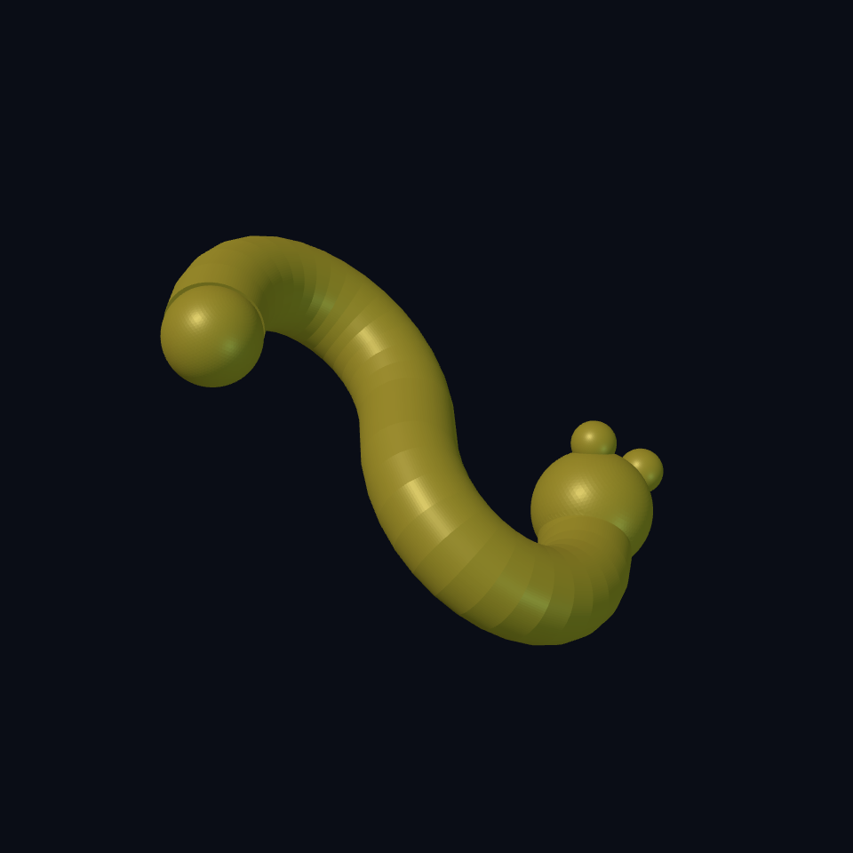

# Chapter 1: A worm with a wiggle

Welcome to **Worm Farm**. Our farmer has no arms, owns a suspiciously large rake, and considers a mushroom a perfectly respectable address. Your job is to build the farm, one useful idea at a time.

By the last chapter you will have a bendy worm, a hollow mushroom house with a removable roof, a rake, a tractor with separate wheels, and a garden fence. More importantly, you will be able to predict what a parameter changes, explain why geometry failed, and export a checked design of your own.

You need Ecky with its native geometry backend. Open a new project, put the complete source below in its code editor, and render. Manual modeling needs no AI connection. A millimetre, written `mm`, is a unit of length; ten of them make a centimetre. These examples are small desk models.

## Meet the farmer {#meet-worm}

The worm is a tube following a curved backbone. Its head and eyes are spheres—round solids. A `sphere` takes a **radius**, the distance from its middle to its skin. `(sphere 3mm)` makes an eye 6 mm across.

A `translate` moves a shape. Its three distances are X, Y, Z: across, along, up. `(translate 52mm 8mm 14mm (sphere 3mm))` puts the eye's **centre** at that address. It does not move the eye's bottom to Z = 14. Its bottom is at 11.

`union` joins overlapping solids. The eyes overlap the head, and the head overlaps the tube. Move an eye far away and it becomes a loose eyeball. Our farmer is dramatic enough already; put it back.

## Make a backbone {#worm-backbone}

A Bézier curve has handles. They pull on its direction and bend; the curve usually does **not** pass through the handles. Think of bending a soft garden hose by steering the ends, rather than sticking pins through every point.

This backbone has two cubic curves joined together. A cubic uses four control points. The second curve shares the first curve's last point, so the list has **seven points**, not eight. Point 1 is the tail; point 4 joins the bends; point 7 meets the head. Points 2, 3, 5, 6 steer the bends.

All backbone points have Z = 6. Its radius is also 6, so the tube reaches the ground at Z = 0. The `bend` control changes the Y positions of the handles. It leaves the tail, middle join, and head connection fixed.

You do not need to derive the curve equation today. Identify which numbers are handles and which are endpoints. That is enough to direct your first creature.

## Give the backbone a body {#worm-source}

A `circle` is a flat outline. `sweep` carries that outline along the backbone to make a solid tube. The tail sphere rounds off the tube's otherwise flat end. Its centre sits 2 mm behind the backbone start, leaving a clear overlap instead of matching the tube's end rim exactly. Read the short source from inside outward: circle + curve → tube; tube + head + eyes → worm.

<!-- example: ../examples/worm-farm/01-worm.ecky -->

[Download the complete worm](../examples/worm-farm/01-worm.ecky)

`model` encloses the whole design. `params` declares the changeable control. `part worm` names the exported object. `let*` names the backbone `spine`, then uses that name to build `body`. Later bindings can use earlier ones. Parentheses group an instruction with its inputs; they are the recipe's bowls, not decoration.

Native Ecky currently samples each cubic Bézier into 16 path segments. The preview is an approximation to the intended curve; slight bands in the render are expected. Tight bends can make a swept body intersect itself. We will keep this control in a tested range instead of promising every imaginable wiggle works.

## Bend, predict, inspect {#worm-experiment}

1. Predict what `bend = 16` changes. The handles move closer to Y = 0; the body should become less wiggly.
2. Render that value. Check that both eyes still touch the head.
3. Try `bend = 30`. Compare the bends, then return to 24.
4. Move one eye's X coordinate from 52 to 90. Find the detached eye, then restore 52.

**You can now:** read a shape's position, distinguish radius from diameter, steer Bézier handles, and explain how a sweep makes a solid. Keep the worm file: the house is next.

Extra practice: [the connected bracket](../projects/01-corner-bracket/02-connected-solution.ecky) teaches the same move-and-join idea with flat faces. Its back flange must overlap its foot; a union cannot invent material across a gap.
