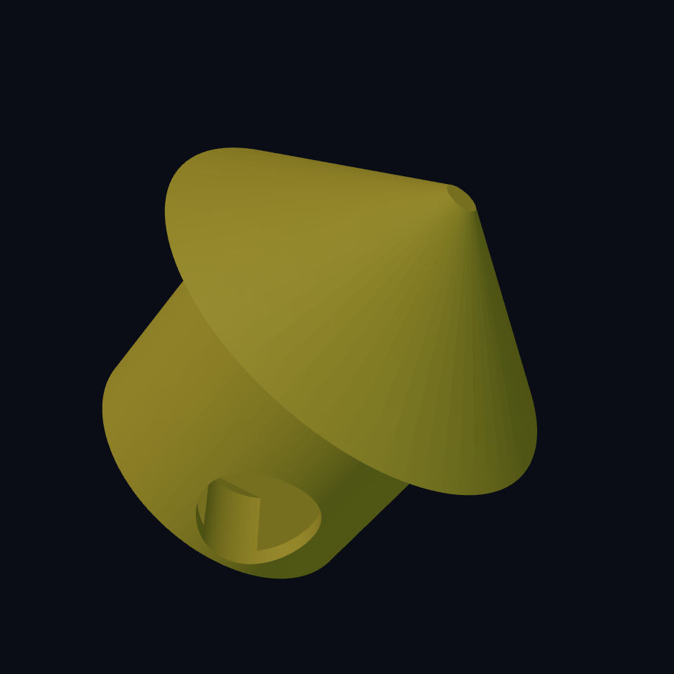

# Chapter 2: A mushroom with a front door

The **Worm Farm** farmer has found a mushroom. Unfortunately it is entirely solid inside. Very good mushroom; very bad house.

Last chapter we **added** material with `union`. This chapter removes it with `difference`. We also learn to keep a roof separate, so our farmer can rearrange the furniture without eating the ceiling.

## Start with the outside {#house-outside}

A `cylinder` takes radius and height, in that order. `(cylinder 18mm 28mm)` is a round house 36 mm across and 28 mm tall. Its default bottom is Z = 0, and its X/Y centre is the origin. A `cone` takes bottom radius, top radius, height. The roof narrows from radius 26 to radius 2 over 18 mm.

Current round primitives take dimensions only. An extra “number of sides” is rejected. For a hexagonal shape, use `(extrude (regular-polygon 6 radius) height)`; we will try that in the garden chapter. A cylinder is round on purpose.

## Scoop out a room {#house-cavity}

A cutter is a shape you subtract. It does not become another exported object. Put the big cylinder first in `difference`, then the smaller room and the doorway.

Our `wall` control is 2 mm. The room radius is `18 - 2 = 16`; its diameter is 32. Its bottom starts at Z = 2, leaving a 2 mm floor. The room is 27 mm tall, so it ends at Z = 29—one millimetre above the outside. That overshoot opens the top cleanly.

The doorway cutter is another cylinder, turned sideways with `rotate`. Angles such as `90deg` are degrees. A cylinder normally points up Z; rotation around X turns its axis along Y. The cutter reaches the front wall and ends inside the room. It does not drill a second door through the back.

## Keep the roof movable {#house-roof}

`part house` and `part roof` are separate pieces. Joining them would give our worm a permanently sealed mushroom. Ordinary `translate` affects the exported position; here it raises the roof to the house's top at Z = 28.

The short plug under the roof fits into the room. Its radius is `18 - wall - roof_clearance`. At the defaults that is 15.7 mm, against the room's 16 mm radius: 0.3 mm of space **per side**, or 0.6 mm across the diameter.

Clearance means room between mating surfaces. It is not a promise that this printer and filament will fit perfectly. Print a short ring and plug before spending time on the complete house.

## Build the house {#house-source}

<!-- example: ../examples/worm-farm/02-mushroom-house.ecky -->

[Download the mushroom house and roof](../examples/worm-farm/02-mushroom-house.ecky)

## Invite a guest, not a wall {#house-experiment}

1. Predict `wall = 3`: the outer size stays fixed; the room and roof plug get smaller.
2. Render, then inspect the doorway and floor. The cutter should cross the wall completely.
3. Change `roof_clearance` from 0.3 to 0.5. Only the plug radius changes; the room does not.
4. For a deliberate failure of design, move the room cutter upward to Z = 8. Rendering can still succeed, but the floor becomes 8 mm thick. A valid solid can still be a bad house.

**You can now:** subtract a cavity, turn a cutter, preserve a floor, and derive a mating dimension from a named clearance. Save both parts for the farm.

Extra practice: [a bottle-frame clamp](../projects/07-bottle-cage/01-frame-clamp.ecky) subtracts a bore from a cylinder; [the peaked dovetail](../projects/03-supportless-dovetail/solution-peaked-roof.ecky) adds a more demanding sliding fit. Work on small samples before a whole mount.
