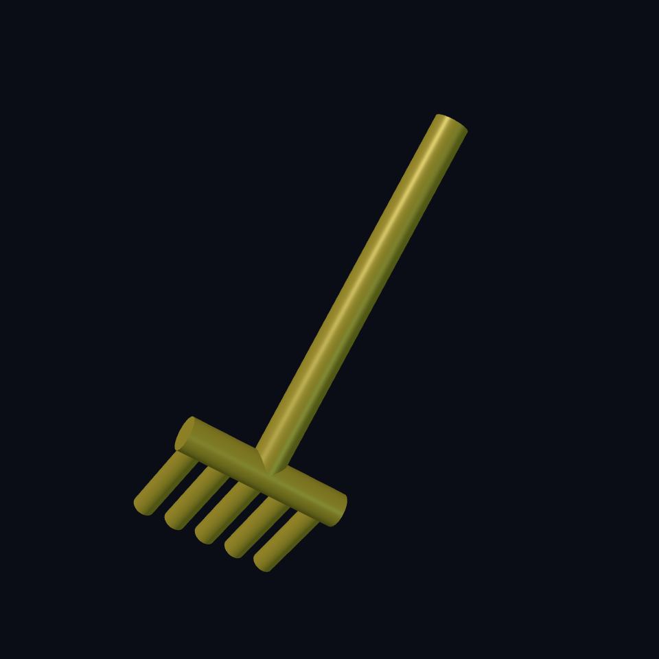

# Chapter 1: A rake with teeth pointing down

Our **Worm Farm** needs a rake. Start with three things you can point to: a handle, a bar, and five teeth. The teeth reach the ground. The handle points up toward the farmer.

Your job: make one tooth, make a row, then change how many teeth the rake has.

## Find up, across, and forward {#rake-directions}

Think of the printer bed as a table. X goes across it, Y goes away from you, Z goes up. A cylinder starts on that table and grows along Z.

Read `(cylinder 1.3mm 12mm)` as “a round tooth, radius 1.3, height 12.” Radius is half the width. The flat tip sits at Z = 0; its other end reaches the bar at Z = 12. The tooth does not need rotating.

Reference: [cylinder](https://ecky-cad.com/docs/primitive-signatures/#cylinder).

## Make the bar and handle {#rake-handle}

The bar crosses X. We turn a cylinder a quarter turn around Y: `rotate 0 90deg 0`. Its length is centred with `:align '(center center center)`, then `translate` lifts it to the tops of the teeth.

The handle starts at the bar too. A smaller turn, `rotate -35deg 0 0`, makes it lean upward and backward. `35deg` means 35 degrees. Imagine holding the real rake: the handle must rise away from the ground while the teeth stay down.

`union` joins overlapping shapes. The tops of the teeth enter the round bar, and the handle enters its middle. Touching in a picture is insufficient; these pieces need shared material.

Reference: [rotate](https://ecky-cad.com/docs/boolean-and-transform-signatures/#rotate), [union](https://ecky-cad.com/docs/boolean-and-transform-signatures/#union).

## Turn one tooth into five {#rake-repeat}

`repeat-union i tooth_count` makes a row and joins it. For five teeth, `i` takes the values 0, 1, 2, 3, 4. We subtract 2 to centre them, then multiply by the 4 mm spacing:

| Tooth | X position |
| --- | --- |
| First | −8 mm |
| Second | −4 mm |
| Middle | 0 mm |
| Fourth | 4 mm |
| Last | 8 mm |

`let*` gives dimensions names. Read `tooth-length` as a labelled ruler. Later expressions can use rulers named above them. `head-length` follows the number of teeth, so its ends stay near the outer teeth.

You can change `tooth_count` in the controls instead of copying and pasting another tooth.

## Build the rake {#rake-source}

<!-- example: ../examples/worm-farm/03-rake.ecky -->

[Download the rake](../examples/worm-farm/03-rake.ecky)

## Try, predict, inspect {#rake-experiment}

1. Open the complete example. Count five teeth. Find their flat tips at Z = 0.
2. Set `tooth_count` to 7. Predict: two more teeth and a longer bar. The handle stays in the middle.
3. Turn the view sideways. The teeth point toward the bed; the handle rises away from it.
4. As a deliberate mistake, change only `head-height` to `20mm`. The teeth no longer reach the bar. Rendering may work, but the connected-piece check should fail. Restore `tooth-length`.

`verify` at the bottom asks for one connected piece. Run model verification after rendering. It catches a detached handle or row of teeth; it cannot decide whether the rake looks good.

**You can now:** read dimensions, turn and move a shape, repeat a tooth, and check that joins actually join. Next, give the farmer a hollow house.
