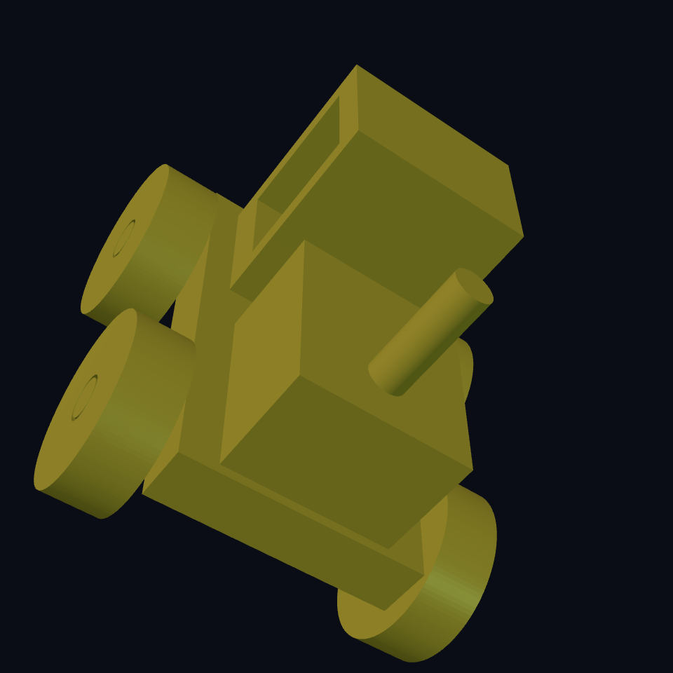

# Chapter 4: The smallest tractor traffic jam

The **Worm Farm** farmer has hired a tractor. It has four wheels, one chimney, and absolutely no driving licence.

We will use a box where it is useful: the chassis is a rectangular support for an engine and cabin. Round wheels come from cylinders. Unlike rake teeth, the wheels should remain **separate** from the chassis.

## Name the pieces {#tractor-plan}

The chassis is one `part`: body, engine, chimney, cabin, and two axle rods joined together. The wheel group is another `part` containing four separate wheels. A part name can hold multiple disconnected solids; two part declarations do not mean two connected pieces.

`box width depth height` makes the body. Like the house cylinder, the default box sits with its bottom at Z = 0 and X/Y centred. We raise the body to `wheel_radius`. The wheel centres use that same height, so their bottoms reach the ground. Change radius and the body rises with them.

## Two loops, four wheels {#tractor-wheels}

One `repeat-compound` selects the side; another selects the axle. A compound groups shapes without fusing them. `side` is 0 or 1. `2 × side - 1` becomes -1 or +1, placing wheel centres at X = -17 or +17 mm. `axle` is 0 or 1, so Y is -13 or +13 mm.

Each wheel is turned around Y to point along X. The `:align '(center center center)` option centres its height along its axis. Otherwise its starting end, rather than its middle, would be placed at X = ±17.

The axle radius is 2 mm. The wheel bore adds `axle_clearance`, so a 0.3 mm radial clearance gives a 2.3 mm bore radius. The bore cutter is 8 mm long, longer than the 6 mm wheel, so it cuts through both sides. You learned that overshoot trick in the mushroom house.

## Build the tractor {#tractor-source}

<!-- example: ../examples/worm-farm/04-tractor.ecky -->

[Download the tractor](../examples/worm-farm/04-tractor.ecky)

## Inspect a useful failure {#tractor-experiment}

1. Set `wheel_radius` from 9 to 11. Predict the ground position before rendering: wheel bottoms remain at zero; chassis rises 2 mm.
2. Follow `axle_clearance` into the bore, not the outer wheel. Increase it to 0.5. The wheels' outside size stays fixed.
3. Replace the **outer** `repeat-compound` with `repeat-union`. The wheels are too far apart to fuse into one solid. Union is not an invisible axle.
4. Restore the compound. Inspect all four bores before export.

This model has no axle end caps or retaining clips; its wheels can slide off. That is a useful next design problem after the farm, not evidence of a finished rolling toy. A printed fit also needs a small axle/bore sample and appropriate adult help with making and assembly.

Extra practice: [the hollow travel shell](../projects/08-gillette-kit/shell-blank.ecky) uses a rounded rectangle and extrusion; [the handle clip](../projects/08-gillette-kit/handle-snap.ecky) has a flexible circular fit. A closed render does not establish flexible strength.

**You can now:** separate moving pieces, place a symmetric pair, nest two repeats, and keep axle clearance distinct from wheel size. Park the tractor beside the house.
