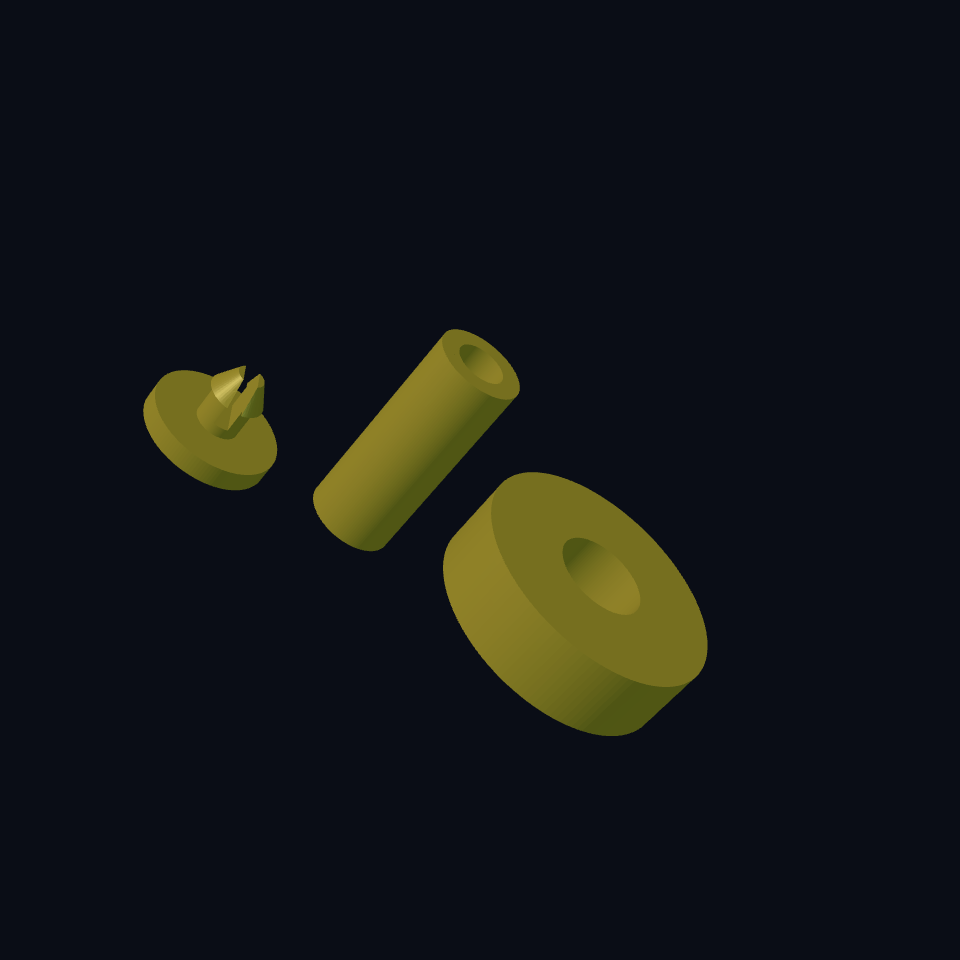
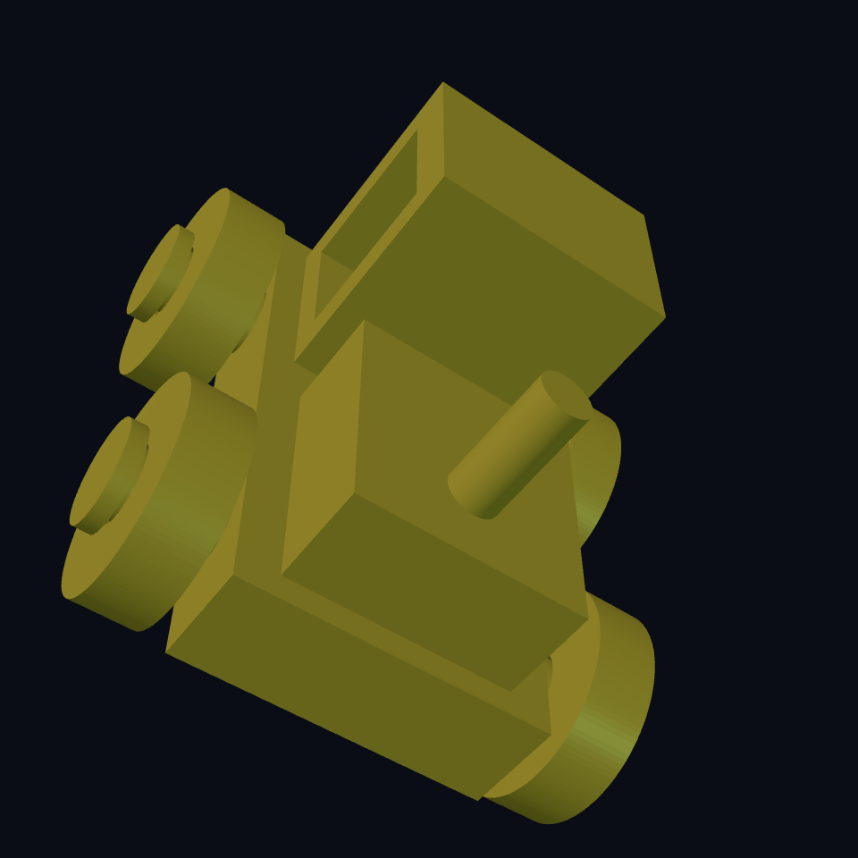

# Chapter 4: Wheels, axles, and snap-on rivets

The **Worm Farm** tractor needs wheels that turn and stay on. A wheel glued to a body cannot roll. A wheel slipped over an open rod falls off. We will print a kit and hold each wheel with a small split rivet.

## Lay out eleven pieces {#tractor-pieces}

Count one body, two axles, four wheels, four rivets: **eleven separate pieces**. No metal rods, glue, or bought fasteners are part of this design.

The body has two sideways holes. Slide an axle through each hole, put a wheel on either end, then push a rivet into each hollow axle end. Its wide head keeps the wheel on.

Start with [the small axle–wheel–rivet sample](../examples/worm-farm/tractor-fit-coupon.ecky). It uses the exact same component recipes as the tractor, with a shorter axle. Print these three pieces before the whole kit. Put the wheel on the axle, push the rivet in, then check: does the wheel turn, and does it stay on when pulled gently?

## Leave space for the wheel {#tractor-running-fit}

The axle radius is 3.2 mm. The wheel hole radius is `axle-radius + wheel_clearance`: 3.6 mm at the default. That leaves **0.4 mm per side** for rotation.

The body is 30 mm wide. Each wheel's inner face sits 2 mm away from it. A second gap, `wheel-end-play`, leaves 0.6 mm between the wheel's outer face and the rivet head. The head holds the wheel without squeezing it against the body.

These gaps have different jobs. A wheel that rubs needs room to spin. A rivet that falls out needs a better catch. Changing one should not silently change the other.

## Let the rivet squeeze, then catch {#tractor-snap-fit}

Picture the rivet in four pieces, all printed as one shape:

1. A broad, flat head stops outside the axle.
2. A narrow stem enters its hole.
3. A tapered tip guides it in. Behind that tip is a wider barb.
4. A slot splits the stem into two flexible legs; the head remains whole.

The axle mouth radius is 1.8 mm. The barb radius adds `snap_interference`, normally 0.25 mm. The legs must squeeze inward while passing through the mouth, then open inside a wider pocket. The pocket's shoulder catches the barb. The head stays outside and retains the wheel.

The source calls the opening's depth `lip-depth`; the barb sits behind that lip after insertion. The slot stops above the head, so the rivet remains one connected piece. Never fuse the rivet to the axle to make a check pass.

The small sample decides the printed fit. If the wheel binds, increase `wheel_clearance`. If the rivet takes too much force, reduce `snap_interference`; if it slips out, inspect the barb and pocket before increasing it. CAD geometry does not establish how a particular filament will bend. Let an adult help print and assemble small pieces.

Reference: [difference](https://ecky-cad.com/docs/boolean-and-transform-signatures/#difference), [define-component](https://ecky-cad.com/docs/components/#define-component).

## Print flat, inspect assembled {#tractor-layout}

`print_layout` starts **on**. Wheels lie flat with their holes facing up, rivets rest on their heads, axles stand on their ends, and the body rests on its underside. Separate the eleven shells in your slicer if it treats the STL as one object. Inspect the cabin roof and axle bores for bridging settings.

Turn `print_layout` **off** to inspect the assembled tractor. The same component recipes move and turn into position. This switch changes exported geometry too: turn it on again before exporting the kit. It is not a preview-only `view`.

The two repeats choose a side and an axle. Four calls make four wheels, then four more calls make the rivets. All share the named fit dimensions.

## Open the complete kit {#tractor-source}

Read the component names first: `tractor-chassis`, `tractor-axle`, `tractor-wheel`, `tractor-rivet`. You do not need to type every line. Start by changing one measured gap in the sample.

<!-- example: ../examples/worm-farm/04-tractor.ecky -->

[Download the tractor](../examples/worm-farm/04-tractor.ecky)

## Try a useful failure {#tractor-experiment}

1. Render the kit and run verification. Expect eleven closed, separate pieces.
2. Inspect assembly mode. Follow the axle through the body and both wheels; find the two retaining heads.
3. Increase `wheel_radius` from 10 to 12. Wheels grow and the body rises; axle and rivet fits stay unchanged.
4. In the sample, temporarily make the rivet slot pass through its head. The rivet splits into two pieces: a real design error. Restore the slot's bottom before printing.

**You can now:** design a running gap and a snap catch, reuse exact mating parts in a cheap sample, and distinguish printable layout from assembled placement. Next comes a joint that bends in more than one direction.
