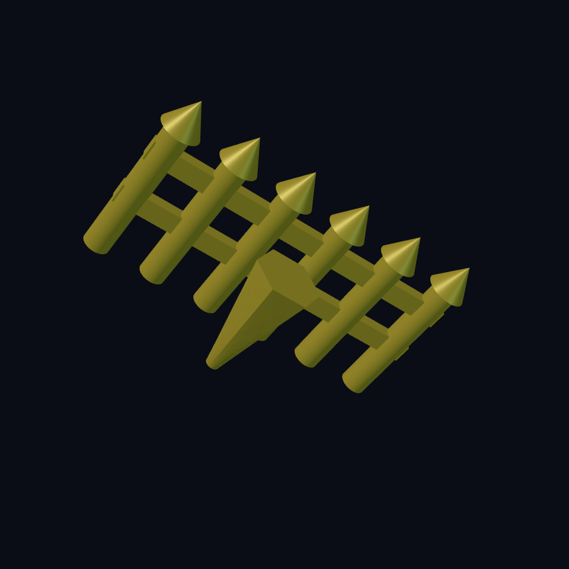

# Chapter 3: A fence, a carrot, and a reusable recipe

The **Worm Farm** has a house and a rake. Now it needs a garden. The farmer requests one carrot and a fence to protect it from the tractor we will build next. Planning is improving.

Repeating a whole expression worked for rake teeth. A fence post adds a pointed cap and may need several dimensions. Give that recipe a name with `define-component`.

## Package one proven post {#garden-component}

A component declaration goes before `model`; its signature lists inputs and defaults. Our `fence_post` accepts `x` and `height`. It builds a cylinder plus a cone, then moves the result to X = `x`. Calling `(fence_post :x 18mm)` uses the default height; calling it with `:height 30mm` overrides that height too.

The colon marks a named input. The name `x` belongs to this component's signature; it is a scalar position, not an implicit coordinate vector.

A component's geometry sees its signature, local bindings, and allowed immutable top-level helpers. It cannot reach arbitrarily into a model's controls. Pass a needed value in the signature. This keeps the recipe usable somewhere else.

## Grow a fence from that recipe {#garden-repeat}

`posts` sets a count, and the repeat calls the component at `i × 9mm`. Six posts land at 0, 9, 18, 27, 36, 45. Two box rails cross them at Z = 8 and 16. Here the rails' length **is derived** from the count, so a longer row gets longer rails too.

The rail length is `(posts - 1) × 9mm + 4mm`. The centre is half the distance from first to last post. That gives a 49 mm rail centred at X = 22.5 for six posts. The extra 4 mm covers the post radii at both ends.

## Grow a ridiculous carrot {#garden-loft}

The carrot's bottom profile is a small circle of radius 1. Its top is an explicit six-sided polygon of radius 5. `loft 18mm` joins those profiles 18 mm apart. This is a deliberately stylised carrot, not a cylinder with an ignored facet count.

A loft joins two outlines at different heights. Changing the top profile changes the carrot's shape without changing its height.

## Build the garden {#garden-source}

<!-- example: ../examples/worm-farm/05-garden.ecky -->

[Download the garden](../examples/worm-farm/05-garden.ecky)

## Reuse without hiding dependencies {#garden-experiment}

1. Increase `posts` from 6 to 8. Predict rail length: `7 × 9 + 4 = 67mm`. Render and count.
2. Add `:height 28mm` to the component call. All posts grow; their caps remain 5 mm tall. The rails stay at their original heights.
3. Change the component body to use an undeclared `magic_height`. Compilation should reject the free variable. Restore `height`.
4. Keep the component definition and copy it into a new model. It should work with its declared inputs alone.

**You can now:** declare reusable geometry, pass named inputs, derive a repeated support's size, and loft a profile into a changing solid. Next chapter uses reusable recipes for wheels, axles, and retaining rivets.
