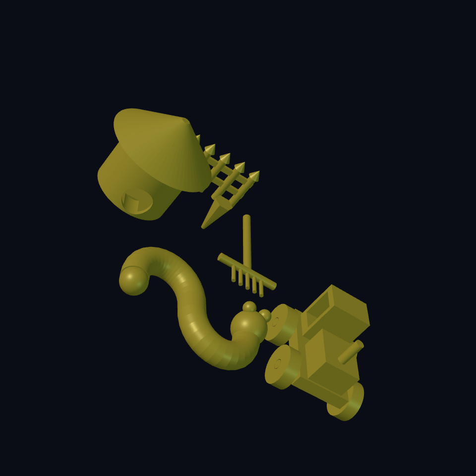

# Chapter 6: Open the gates, check the farm

Welcome to the complete **Worm Farm**. The worm has moved in, the mushroom has a roof, and the tractor has only run over the carrot twice.

This chapter adds no mysterious replacement models. The complete source contains the same worm, house, rake, tractor, and garden you already built. Their familiar parts are moved into a shared layout. You can trace every piece back to an earlier chapter.

## Put the objects on one map {#farm-layout}



The final model has seven controls. The worm's wiggle, house wall, roof clearance, axle clearance, rake count, wheel radius, and fence count retain their original jobs. Roof and axle fits have different names: a tighter roof should not silently change the tractor's wheels.

Each `part` gets an outer `translate`. The house and roof move together by the same X/Y offset. The chassis and wheel group also share an offset. Moving only a roof or only the wheels would break an assembly relationship even though each solid still renders.

This scene has no ground slab. Z = 0 is a coordinate plane, not exported soil. The real shapes remain the deliverable.

## Peek under the roof {#farm-view}

The authored `view` named `peek_inside` offsets the roof upward for inspection. View offsets are **preview-only**; they do not change STL or STEP geometry. A normal `translate` inside a part changes export geometry. Naming a variable `preview` does not alter this rule.

The committed illustration shows exported assembled positions, not that exploded view. Inspect the house's standalone source if a particular viewer does not offer named views.

## Ask a measurable question {#farm-verify}

`verify` writes a requirement alongside geometry. Our check asks that the exported STL has zero non-manifold edges. It does **not** demand one connected component: separate roof and wheels are intentional. Do not “fix” them by fusing the farm into one blob.

A check has a tag, a metric, and an expectation. `closed_farm` names this check; `bad_edges` names the measured number; `(= 0)` defines a passing result. Rendering and verification are separate actions: use Ecky's model verification after a successful render. A command-line `check` only compiles the source; a declared verification is not evidence that it ran.

Passing mesh checks cannot certify roof fit, tyre friction, stability, strength, or print safety. Those need their own inspections and, for a physical model, small printed samples.

## Read the complete farm {#farm-source}

<!-- example: ../examples/worm-farm/06-farm.ecky -->

[Download the complete farm](../examples/worm-farm/06-farm.ecky)

Start at the part names. Collapse everything you already understand, then compare each outer placement with the previous chapter's local coordinates. Long source becomes readable when its pieces have names and a history.

## Make your own farm {#farm-finish}

1. Choose one change: a wider worm bend, eight fence posts, a larger wheel, or a different house wall.
2. Write a prediction before rendering. Which dimensions should change, and which should stay fixed?
3. Render and run model verification. Inspect the roof plug, door, wheel bores, and repeated joins.
4. Export STL for a slicer. Export STEP only when the rendered artifact offers it; mesh paths may not provide STEP.
5. Reopen an export in a viewer. Count expected objects, check scale, and inspect your change. Separate pieces may need separate export or separation in the receiving tool.

From a prepared repository, the command-line equivalents begin with:

```bash
src-tauri/target/debug/ecky check farm.ecky
src-tauri/target/debug/ecky render --backend native farm.ecky --stl farm.stl --step farm.step --json
```

The CLI commands compile and render; they do not execute the authored runtime verification. Keep the verification result from the app or your test harness with the exported design.

For a more demanding mechanism, [the film scanner](../../../../sites/landing/src/models/film-scanner.ecky) combines rails, film inserts and a threaded carrier. Inspect shared pitch and clearance before editing a helix. Ordinary source translations affect exports; only `view` offsets are preview-only.

**You can now:** assemble familiar geometry, distinguish scene placement from inspection views, state a measurable requirement, and export a design with an honest account of what was checked. Your next project can be another farm building—or a worm-sized spaceship. Start with a prediction and one new idea.
